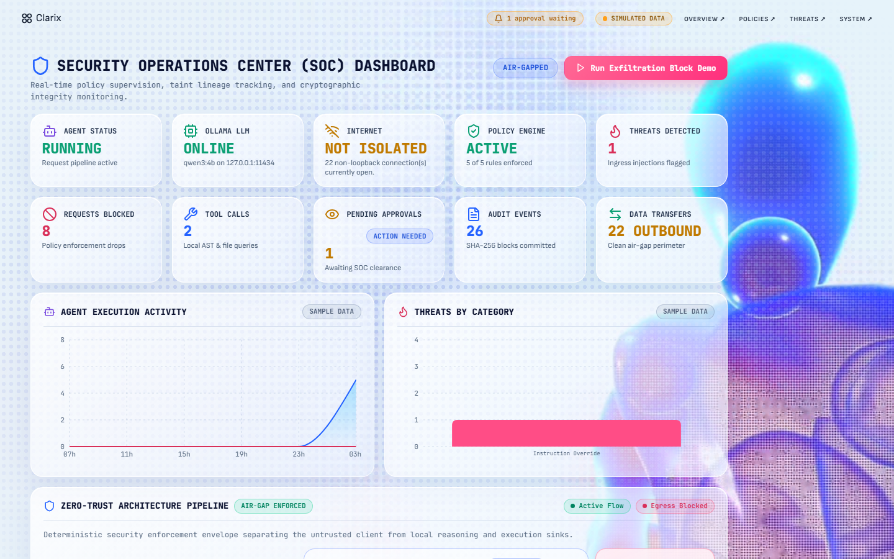
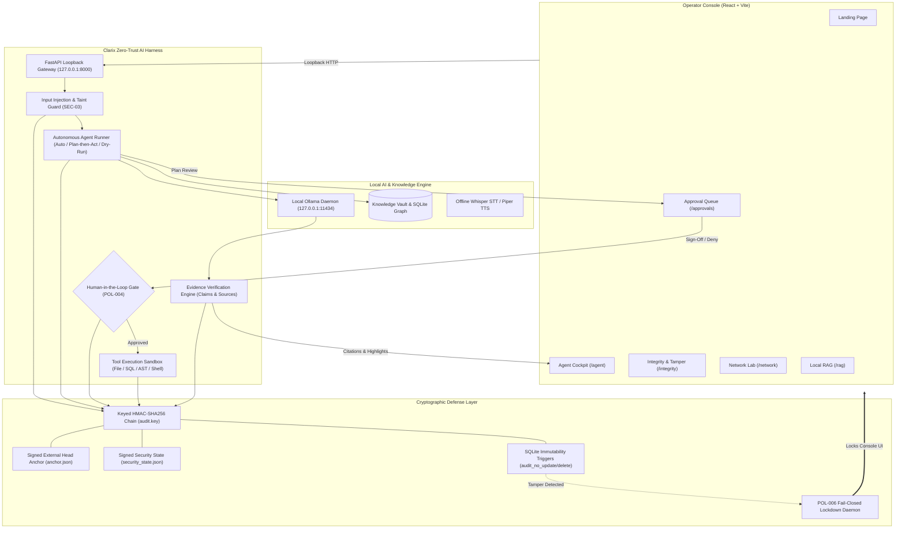

# Clarix AI — Air-Gapped Secure AI Agent Platform

> **Zero-Trust AI harness for local language models, built for classified, air-gapped and high-assurance environments.**

[](https://github.com/TheSuhasDev/clarix-ai/actions/workflows/ci.yml)
[](backend/tests/)
[](#security-guarantees)
[](LICENSE)



---

## The Pitch

**The Problem.** Defence, intelligence, government, healthcare, and critical infrastructure teams urgently want the productivity of autonomous AI agents, but they cannot send classified data to the cloud. Furthermore, raw local LLMs cannot be trusted out-of-the-box:
1. They can be hijacked via indirect prompt injection hidden inside ingested documents or incoming data.
2. They can hallucinate ungrounded answers and invent fake citations.
3. They can execute unauthorized tools, abuse shell access, or exfiltrate sensitive files.
4. Standard SQLite or plain SHA-256 audit logs can be rewritten and re-hashed by an adversary without leaving a trace.

**The Solution.** Clarix AI wraps local open-weights language models (via Ollama) in an uncompromising Zero-Trust security harness:
- **Every prompt and document chunk** is screened for injection across 12 languages before inference.
- **Every agent workflow** supports **Plan-then-Act** review and **Dry-Run** preview diffs before touching tools.
- **Every high-risk action** (shell execution, restricted file access) is suspended behind an authorized **Human-in-the-Loop Approval Gate** with a live 300s countdown timer.
- **Every answer** is validated claim-by-claim by the **Evidence Verification Engine**, highlighting exact source passages and citation locators directly below the response.
- **Every single event** is sealed in a **Keyed HMAC-SHA256 Audit Ledger** backed by 4 independent cryptographic defense layers (air-gapped HMAC key, signed external head anchor, signed security state, and SQLite immutability triggers) that immediately trigger **POL-006 Fail-Closed Lockdown** upon tampering.
- **Zero data leaves the machine**: enforced in-process at the socket layer and reinforced with OS kernel firewall rules.

---

### What Makes Clarix AI Different

| Capability | Typical Local LLM UI | Clarix AI Platform |
|---|---|---|
| **Air-Gap Enforcement** | Self-claimed offline | In-process socket interception + OS kernel firewall rules (nftables/iptables/pf) |
| **Ingress Injection Defense** | None / basic regex | Multi-vector scanner (42 attack vectors, 12 languages, base64, leetspeak, zero-width chars) |
| **Agent Autonomy Control** | Uncontrolled tool loops | **Auto**, **Plan-then-Act** (operator sign-off), and **Dry-Run** preview diff modes |
| **Human-in-the-Loop Queue** | None | Cryptographic gate (`/approvals`) with 300s countdown, mandatory denial notes, and live cockpit sync |
| **Evidence & Citation Verification** | Untrusted model text | Claim-level Evidence Verifier (`VERIFIED`, `PARTIAL`, `UNVERIFIED`) with passage highlights |
| **Audit Ledger Security** | Plain SQLite or simple SHA-256 | Keyed HMAC-SHA256 chain + external signed anchor + signed security state + immutability triggers |
| **Tamper Detection** | Blind to hash recomputation | **POL-006 Fail-Closed Lockdown** detects re-hashed attacks and table modifications within 2.5s |
| **Network Lab & SOC Monitor** | None | Full simulated network topology with incident correlation and AI-guided root cause remediation |
| **Voice Interaction** | Cloud speech APIs | 100% offline Whisper Flow (STT) + Piper ONNX (TTS) with zero audio retention |

---

## Table of Contents

1. [Features & Subsystems](#features--subsystems)
2. [Tech Stack](#tech-stack)
3. [System Architecture](#system-architecture)
4. [Installation & Setup](#installation--setup)
5. [Autonomous Agent Modes & Human Approvals](#autonomous-agent-modes--human-approvals)
6. [Cryptographic Integrity & Tamper Demo](#cryptographic-integrity--tamper-demo)
7. [Evidence Verification Engine](#evidence-verification-engine)
8. [Simulated Network Lab](#simulated-network-lab)
9. [Offline Voice Subsystem](#offline-voice-subsystem)
10. [Security Policies (POL-001 – POL-008)](#security-policies)
11. [Testing & Verification](#testing--verification)
12. [Project Structure](#project-structure)
13. [Team & License](#team--license)

---

## Features & Subsystems

### Security Guarantees

- **Guaranteed Physical & Socket Air-Gap (POL-001)**: The Python runtime installs a socket-level egress trap blocking any outbound connection attempts to non-loopback addresses (`0 bytes egress`).
- **Input & Retrieval Sanitization (POL-002, POL-003)**: Prompts, RAG chunks, and tool inputs pass through strict injection scanners detecting jailbreaks, prompt leaks, system prompt overrides, and recursive payload executions.
- **Least-Privilege Tool Execution (POL-003)**:
  - Realpath-jailed file reader (confined strictly to `./data/workspace`).
  - AST-parsed math evaluator (no `eval()` or code execution).
  - Read-only SQLite query authorizer (blocks `DROP`, `INSERT`, `UPDATE`, `ALTER`).
  - Allow-listed shell commands requiring explicit operator capability tokens.
- **Taint Tracking & Exfiltration Barrier (POL-005)**: Tracks data sensitivity from source documents (`PUBLIC`, `INTERNAL`, `CONFIDENTIAL`, `RESTRICTED`) through context windows to prevent leakage into lower-tier sinks.
- **Keyed Cryptographic Audit Seal (POL-006)**: Every event is hashed with an air-gapped HMAC-SHA256 key (`data/audit.key`). An out-of-band anchor file (`data/anchor.json`) and signed state file (`data/security_state.json`) guarantee that direct database tampering triggers instantaneous fail-closed lockdown.

---

## Tech Stack

| Layer | Technologies |
|---|---|
| **Frontend UI** | React 18, TypeScript, Vite, React Router v6, Lucide React, Recharts, React Flow |
| **Backend Core** | Python 3.10+, FastAPI, Uvicorn, SQLite3 with WAL mode and custom C-level triggers |
| **Local LLM Engine** | Ollama loopback (`127.0.0.1:11434`) running Llama 3, Qwen 2.5, Mistral, Phi-3 |
| **Embeddings & RAG** | `nomic-embed-text` via Ollama with cosine similarity; lexical hash fallback; knowledge graph extraction |
| **Voice Processing** | `faster-whisper` (CTranslate2 INT8) for STT; Piper ONNX neural voices / OS SAPI for TTS |
| **Cryptographic Security** | HMAC-SHA256, Web Crypto API, AES-256 envelope encryption, capability tokens |
| **Network Lab** | Simulated multi-node topology, telemetry stream, automated diagnostic engine |
| **Quality & CI** | 241 unit & integration tests, GitHub Actions CI workflow |

---

## System Architecture



---

## Installation & Setup

### Prerequisites

- **Python 3.10+**
- **Node.js 18+** and **npm**
- **[Ollama](https://ollama.com)** installed and listening on `127.0.0.1:11434`

```bash
# Pull required local models
ollama pull llama3
ollama pull nomic-embed-text
```

### 1. Backend Setup

```bash
cd backend
python -m venv .venv

# On Linux / macOS:
source .venv/bin/activate
# On Windows:
.venv\Scripts\activate

pip install -r requirements.txt
cp .env.example .env

# Verify host isolation and configuration
python -m clarix --check

# Launch the Clarix API daemon (default: http://127.0.0.1:8000)
python -m clarix
```

### 2. Frontend Setup

```bash
cd frontend
npm install
cp .env.example .env.local
```

Ensure your `.env.local` contains:
```env
VITE_API_URL=http://127.0.0.1:8000
VITE_USE_MOCKS=false
```

```bash
# Launch Vite development server
npm run dev
# Or build production assets
npm run build
```

Open `http://localhost:5173` in your browser.

---

## Autonomous Agent Modes & Human Approvals

The **Autonomous Agent Cockpit** (`/agent`) provides three distinct operational execution modes:

1. **Auto Mode**: The agent plans and executes authorized low-risk tools sequentially within its token and step budget.
2. **Plan-then-Act Mode**: The agent analyzes the user's prompt, decomposes it into structured steps, evaluates tool risk against active policies, and pauses execution in `AWAITING_PLAN_APPROVAL` status.
3. **Dry-Run Mode**: Generates a complete preview diff showing exact proposed tool calls, expected resource modifications, and predicted data classifications without making any changes.

### Human-in-the-Loop Approval Queue (`/approvals`)

When an action requires authorization (such as an agent executing in Plan-then-Act mode, invoking an operator shell command, or reading `CONFIDENTIAL` or `RESTRICTED` data):
- The pending item appears instantly in `/approvals` and increments the live sidebar counter badge.
- Each approval card displays:
  - **Action in plain words** along with numbered planned steps and tool names.
  - **Assigned agent role** (`RESEARCHER`, `ANALYST`, `OPERATOR`).
  - **Risk and Data Classification** badges.
  - **Live 300-Second Countdown Timer** indicating remaining validity before automatic fail-closed expiration.
  - Direct link to inspect the execution thread in the Agent Cockpit (`/agent?runId=...`).
- **Approve**: Resumes or starts execution immediately in the cockpit.
- **Deny**: Prompts the operator for a **mandatory justification note** and cancels the run (`REJECTED`).
- **Auto-Expiry**: Unhandled requests automatically transition to Resolution History as `EXPIRED` with the system audit note.

---

## Cryptographic Integrity & Tamper Demo

Clarix enforces **POL-006 (Cryptographic Tamper Lockdown)** through four independent defense layers:

1. **Keyed HMAC-SHA256 Chain**: Every audit row's hash is computed using an isolated 256-bit secret key (`data/audit.key`).
2. **External Signed Head Anchor**: The latest ledger head hash and record count are sealed in `data/anchor.json` outside the database file.
3. **Signed Security State**: Active policy states, tool permission levels, and classification schemas are cryptographically signed in `data/security_state.json`.
4. **SQLite Immutability Triggers**: Native database triggers (`audit_no_update` and `audit_no_delete`) abort any direct out-of-band SQL modifications.

### 90-Second Adversary Attack Demo

Test Clarix's tamper detection against a sophisticated adversary who rewrites history and recalculates SHA-256 hashes:

```bash
# 1. View current demo ledger events (all verified)
python tools/attack_demo.py --list

# 2. Smart Adversary Attack: Alter row 14 (BLOCK -> ALLOW) and recompute downstream SHA-256 chain
python tools/attack_demo.py --edit-row 14 --rehash

# 3. Naive Verifier Blindness: Run traditional verifier
# -> Reports 100% CLEAN because hash links appear unbroken!
python tools/attack_demo.py --legacy-verify

# 4. Observe Clarix: Within 2.5 seconds, Clarix detects the HMAC key mismatch,
# anchor discrepancy, and triggers POL-006 Fail-Closed Lockdown across the console.
```

To recover and rebaseline the system:
1. Click **Recover System** in the lockdown overlay.
2. Enter the cryptographic confirmation phrase: `I CONFIRM REBASELINE OF SECURITY STATE`.
3. Provide a mandatory 20+ character security justification note.

---

## Evidence Verification Engine

Under every answer generated by the agent or RAG system, Clarix renders an inline verification card:

- **Verification Badge**:
  - `✓ VERIFIED`: All statements are backed by citations matching ingested document text.
  - `▲ PARTIAL`: Some statements rely on weak semantic overlap or missing locators.
  - `✕ UNVERIFIED`: No supporting evidence found or claims contradict reference material.
- **Claim Metrics**: Reports `N claims · N cited · N weak`.
- **Interactive Source Chips**: Displays `[1]`, `[2]` chips with document name, exact page/section locator (`p. 4`), data classification, and cosine relevance score.
- **Passage Viewer**: Expanding the evidence card reveals the exact retrieved document chunk with the matching sentence highlighted.

---

## Simulated Network Lab

Clarix includes a complete offline **Network Security Lab** (`/network`):

- **Interactive Topology Map**: Visualizes Core Switches, Firewalls, Edge Routers, and Host Devices with live link throughput and health metrics.
- **Scenario Testing**: Switch between *Demo 1 (Healthy Core Network)* and *Demo 2 (Core Switch Degradation & BGP Flapping)*.
- **AI Investigation Cockpit** (`/network/investigation`):
  - Click **Analyze Network with Clarix AI** to trigger an automated multi-step diagnostic trace.
  - Correlates telemetry metrics, logs, and topology states to isolate root causes.
  - Recommends and applies one-click automated remediation (e.g., dynamic link rerouting and interface isolation).

To launch the standalone network service:
```bash
# Windows
start-network.bat

# Or manual execution
python -m clarix.network_service --port 8081
```

---

## Offline Voice Subsystem

Clarix provides speech input and output that operates 100% offline with zero external network connectivity or audio retention:

- **Whisper Flow (STT)**: Powered by `faster-whisper` (CTranslate2 INT8). Audio is streamed into RAM, transcribed, and immediately purged from memory. Transcripts are passed through the input injection guard. Toggled via `Ctrl + Shift + Space` or policy **POL-008**.
- **Neural Voice (TTS)**: Piper ONNX neural models synthesize audio locally without external telemetry. Redacts sensitive credentials, URLs, and token hashes prior to speech output. Toggled via `Ctrl + Shift + S` or policy **POL-007**.

---

## Security Policies

| Policy ID | Policy Name | Enforcement Mechanism |
|---|---|---|
| **POL-001** | Air-Gap Isolation | In-process socket interception + OS firewall blocking all non-loopback egress |
| **POL-002** | Sensitive File Protection | Rejects path traversal (`..`), symlink escapes, and protects `.env` and system configs |
| **POL-003** | Least-Privilege Tools | AST-only math, read-only SQL authorizer, restricted command allow-lists |
| **POL-004** | Human Approval Gate | Suspends risky actions with a 300s countdown timer pending operator signature |
| **POL-005** | Data Taint & Exfiltration | Halts inference pipeline if confidential data is routed toward an external sink |
| **POL-006** | Cryptographic Integrity | Keyed HMAC-SHA256, signed head anchor, signed security state, SQLite triggers |
| **POL-007** | Local Speech Synthesis | Instantly enable or disable neural voice output |
| **POL-008** | Local Speech Recognition | Instantly enable or disable offline microphone speech transcription |

---

## Testing & Verification

The Clarix test suite contains **241 automated tests** covering security policies, injection detection, RAG retrieval, agent runner modes, and cryptographic tamper defense.

```bash
# Run all 241 backend unit and integration tests
cd backend
python -m unittest discover -s tests -t . -v

# Run SEC-03 prompt injection evaluation suite
python -m unittest tests.test_security_evaluation

# Run frontend type-check and production build
cd frontend
npm run typecheck
npm run build
```

### Prompt Injection Detection Benchmark (SEC-03)

| Attack Category | Test Samples | Detected | Detection Rate |
|---|---|---|---|
| **Direct Jailbreaks & Overrides** | 8 | 8 | **100.0%** |
| **Indirect / Document Injection** | 6 | 6 | **100.0%** |
| **Base64 / Hex Encoded Payloads** | 4 | 4 | **100.0%** |
| **Spaced & Obfuscated Attacks** | 6 | 6 | **100.0%** |
| **Multi-Language Attacks** (Hindi, Arabic, Chinese, French, etc.) | 18 | 18 | **100.0%** |
| **Benign Operational Prompts (False Positives)** | 15 | 0 | **0.0% Clean** |

---

## Project Structure

```
clarix-ai/
├── backend/
│   ├── clarix/
│   │   ├── agent.py              # Single-turn conversational pipeline & verifier bridge
│   │   ├── agentic/              # Multi-step autonomous runner (Auto, Plan-then-Act, Dry-Run)
│   │   ├── airgap/               # In-process socket egress guard & host posture checks
│   │   ├── approvals.py          # Human-in-the-loop approval queue & grant manager
│   │   ├── integrity.py          # Keyed HMAC chain, anchor verification & fail-closed engine
│   │   ├── llm/                  # Loopback Ollama client & model router
│   │   ├── rag/                  # Document ingestion, vector embeddings, evidence verifier
│   │   ├── security/             # SEC-03 injection scanners, taint tracker, secret filter
│   │   ├── tools/                # Execution sandboxes (file reader, calculator, SQLite, shell)
│   │   └── web/                  # FastAPI routes, middleware, and request validation
│   ├── data/                     # Local SQLite databases, audit.key, anchor.json, security_state.json
│   ├── tests/                    # 241 unit, integration, and security test suites
│   └── requirements.txt
├── frontend/
│   ├── src/
│   │   ├── components/           # UI primitives, TopBar, Sidebar, ErrorBoundary, Cards
│   │   ├── network/              # Simulated Network Lab pages, topology visualizer, services
│   │   ├── pages/                # 19 console views (Agent, Integrity, Approvals, RAG, etc.)
│   │   ├── services/             # Frontend API clients and WebSocket bindings
│   │   ├── state/                # Global ConsoleContext & settings persistence
│   │   └── styles/               # Design system tokens, layouts, and animations
│   ├── package.json
│   └── vite.config.ts
├── tools/
│   ├── attack_demo.py            # Live adversary attack script for judge demonstrations
│   └── update_project_guide.py   # Automated documentation synchronizer
├── start-network.bat             # Convenience script to start the Network Lab service
├── Dockerfile                    # Container definition for air-gapped containerized deploys
└── README.md
```

---