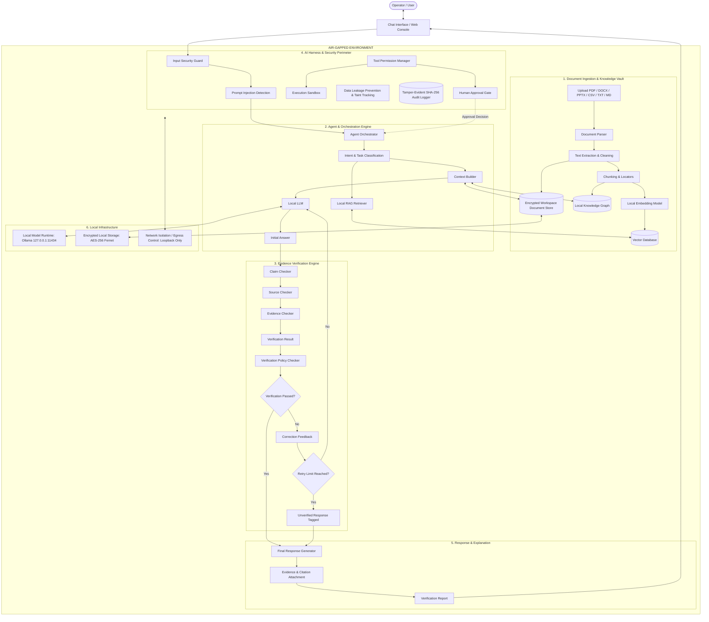

# Clarix AI — Air-Gapped Secure AI Agent Platform

> **Zero-Trust AI Harness & Policy-Enforced Local Agent Environment**  
> Designed for classified, air-gapped, and high-assurance defense-in-depth environments.

---

## Overview

**Clarix AI** is an enterprise-grade, air-gap-oriented autonomous AI agent platform. It isolates local language models inside a strict Zero-Trust security harness, enforcing multi-layered defenses before, during, and after model inference. 

Clarix guarantees that:
- **No data leaves the host**: An in-process egress guard blocks outbound TCP/UDP/DNS requests at the socket level, complemented by kernel-level firewall configurations (`nftables`, `iptables`, `pf`) and systemd cgroup restrictions.
- **Untrusted data cannot hijack the agent**: Every prompt and retrieved document chunk is screened for prompt injection, jailbreak attempts, and indirect instruction poisoning.
- **Tools operate with least privilege**: Tools run inside hardened sandboxes with realpath containment, AST expression evaluators (no `eval`), and read-only SQLite authorizers. High-risk actions halt execution for cryptographic human approval.
- **Attribution is provable**: The Evidence Verification Engine decomposes answers into factual claims, validates citation locators, evaluates semantic evidence support, and provides structured feedback for iterative refinement.
- **Audit logs cannot be silently altered**: Every action, tool invocation, policy decision, and approval is written to an append-only, SHA-256 hash-chained tamper-evident audit ledger.

---

## Architectural Blueprint



---

## Key Features & Subsystems

### 1. Document Ingestion & Knowledge Vault
- **Supported Formats**: `.pdf`, `.docx`, `.pptx`, `.csv`, `.txt`, `.md`.
- **Injection Quarantine**: Ingested chunks are screened for injection patterns; malicious chunks are quarantined and excluded from retrieval.
- **Locators**: Real page numbers for paginated documents (`p. 4`), section locators (`section 2/5`) for non-paginated files.
- **Knowledge Graph**: Extracts entities (policies, protocols, tools, roles) and relationships into local SQLite tables (`kg_entities`, `kg_relations`).
- **Dense Vector Embeddings**: Local embeddings via Ollama (`nomic-embed-text`) with automatic fallback to a deterministic lexical hash embedder (`hash-lexical-v1`).

### 2. Agent & Orchestration Engine
- **Intent & Task Classification**: Classifies queries into `RAG_QUERY`, `TOOL_EXECUTION`, `SECURITY_ADMIN`, and `CONVERSATIONAL`.
- **Knowledge Graph Enrichment**: Enriches prompts with entity relationship triplets before inference.
- **Local Model Routing**: Reaches local Ollama instances over loopback only (`127.0.0.1:11434`), supporting models such as `llama3`, `qwen`, `mistral`, and `phi`.

### 3. Evidence Verification Engine
- **Claim Checker**: Decomposes responses into atomic factual statements.
- **Source Checker**: Validates citation numbers against retrieved source indices ($1 \le n \le N$).
- **Evidence Checker**: Analyzes content word overlap, named entity presence, and numeric quantity consistency.
- **Policy Enforcement**: Enforces tiered verification thresholds based on document classification (`PUBLIC`, `INTERNAL`, `CONFIDENTIAL`, `RESTRICTED`).
- **Correction Feedback Loop**: Generates specific rewrite guidance and triggers re-prompting if verification fails.

### 4. AI Harness & Security Perimeter
- **Input Security Guard & Prompt Injection Detection**: Scans inputs across multiple attack vectors (delimiter escapes, role assumption, system prompt exfiltration, leetspeak, zero-width spaces, and base64 payloads).
- **Tool Permission Manager**: Configurable permission levels (`DISABLED`, `NORMAL`, `RESTRICTED`, `CRITICAL`).
- **Human Approval Gate**: Suspend-and-resume state machine with atomic compare-and-set, 300-second expiration, and time-boxed grant management.
- **Execution Sandbox**: File reader constrained by realpath containment; safe calculator using Python's `ast` allow-list; read-only SQLite authorizer; shell tool with command allow-list.
- **Taint Tracking & Data Leakage Prevention**: Taint tags propagate from sources to execution sinks (`POL-005`). Secret sanitization redacts credentials and API keys.
- **Tamper-Evident Audit Ledger**: SQLite triggers enforce append-only constraints; records are chained via `SHA-256(prev_hash + canonical_json)`.

### 5. Response & Explanation
- **Citation Chips**: Interactive `[n]` citation chips in the chat UI.
- **Sources Drawer**: Collapsible panel displaying cited passages, locators, classification levels, and relevance scores.
- **Verification Reports**: Displays total claims, cited statements, and weak evidence flags.

### 6. Local Infrastructure
- **Encrypted Local Storage**: AES-256 envelope encryption at rest for documents and workspace data with local vault keys.
- **Egress Guard**: In-process socket interception stopping non-loopback connections, complemented by kernel firewall rules.

---

## Quick Start Guide

### Prerequisites
- Python 3.10+
- Node.js 18+ and npm
- [Ollama](https://ollama.ai) (bound to `127.0.0.1:11434`)
  ```bash
  ollama pull llama3
  ollama pull nomic-embed-text
  ```

### 1. Clone & Set Up Backend

```bash
cd backend
python -m venv .venv

# On Linux/macOS:
source .venv/bin/activate
# On Windows:
.venv\Scripts\activate

pip install -r requirements.txt
cp .env.example .env
```

Verify backend configuration and host posture:
```bash
python -m clarix --check
```

Start the backend server:
```bash
python -m clarix
# Running on http://127.0.0.1:8000 (Docs at http://127.0.0.1:8000/docs)
```

Run backend unit and integration tests (146 tests):
```bash
python -m unittest discover -s tests -t . -v
```

### 2. Set Up Frontend

```bash
cd frontend
npm install
cp .env.example .env.local
```

Ensure `.env.local` points to the backend:
```env
VITE_USE_MOCKS=false
VITE_API_URL=http://127.0.0.1:8000
VITE_OLLAMA_URL=http://localhost:11434
```

Start the Vite development server:
```bash
npm run dev
# Running on http://127.0.0.1:5173
```

Build for production:
```bash
npm run build
```

---

## Agent Chat Slash Commands

In the AI Agent console, operators can use slash commands:

| Command | Description |
|---|---|
| `/rag list` | Lists all documents indexed locally with classification and chunk counts. |
| `/rag search <query>` | Performs vector similarity retrieval without invoking the LLM. |
| `/rag ask <question>` | Generates an answer strictly from local documents with citations and verification. |
| `/rag sources` | Inspects the sources and verification metadata behind the last answer. |

---

## Security Policies Reference

| Policy ID | Policy Name | Description |
|---|---|---|
| **POL-001** | Air-Gap Isolation | Blocks all outbound socket connections to non-loopback addresses. |
| **POL-002** | Sensitive File Protection | Restricts file access to the workspace directory; protects `.env` and system configs. |
| **POL-003** | Tool Least Privilege | Limits tool executions to allow-listed binaries, read-only SQL, and AST math. |
| **POL-004** | Human Approval Gate | Suspends execution and requires operator approval for high-risk or classified actions. |
| **POL-005** | Prevent Data Exfiltration | Halts pipeline if tainted confidential/restricted data attempts to reach external sinks. |
| **POL-006** | Cryptographic Integrity Lockdown | Enforces keyed HMAC hash-chains, external signed anchors, signed security state, and fail-closed lockdown on tamper. |

---

## Documentation Index

Detailed guides are available in the [`docs/`](file:///c:/Users/suhas/Desktop/clarix-ai/docs) directory:

- [System Architecture Specification](file:///c:/Users/suhas/Desktop/clarix-ai/docs/ARCHITECTURE.md)
- [REST API Reference](file:///c:/Users/suhas/Desktop/clarix-ai/docs/API_REFERENCE.md)
- [Zero-Trust Security Policies](file:///c:/Users/suhas/Desktop/clarix-ai/docs/SECURITY_POLICIES.md)
- [Air-Gapped Deployment & Host Isolation Guide](file:///c:/Users/suhas/Desktop/clarix-ai/docs/DEPLOYMENT_AIRGAP.md)

---

## License

This project is licensed under the Apache 2.0 License.
